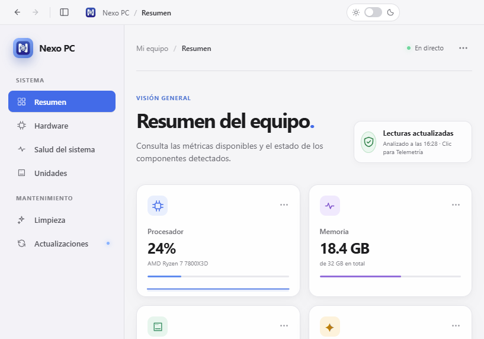
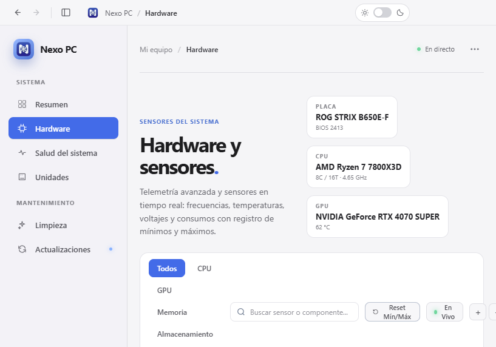
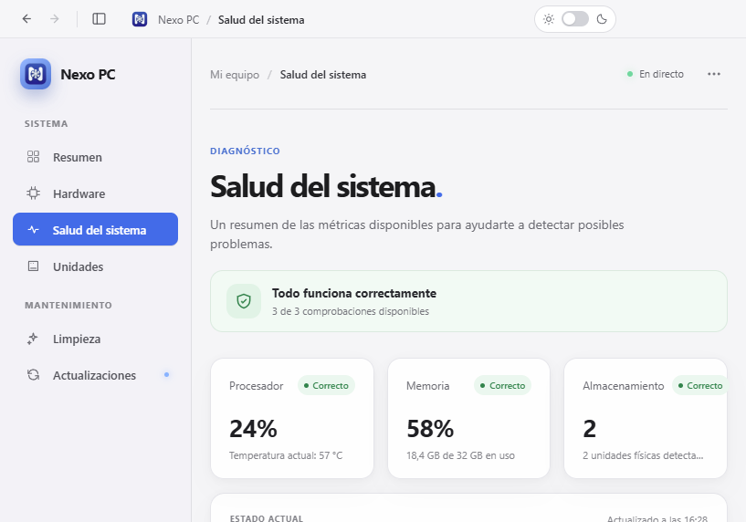
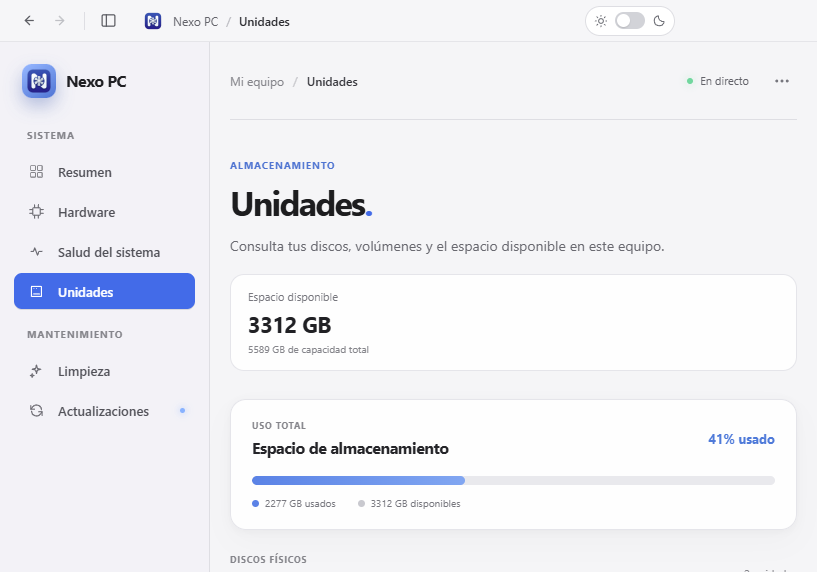
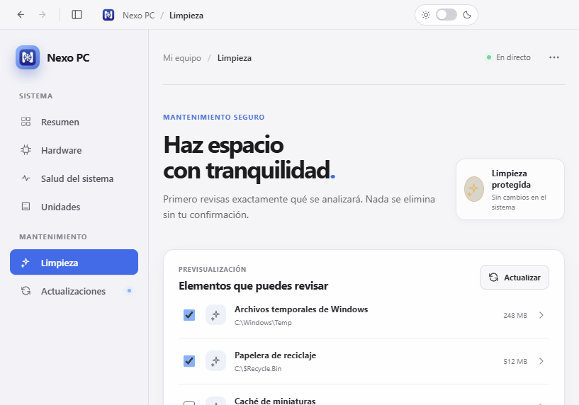
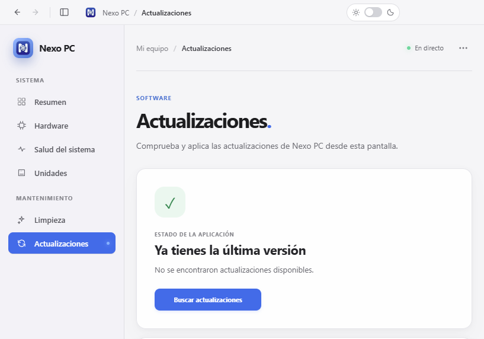
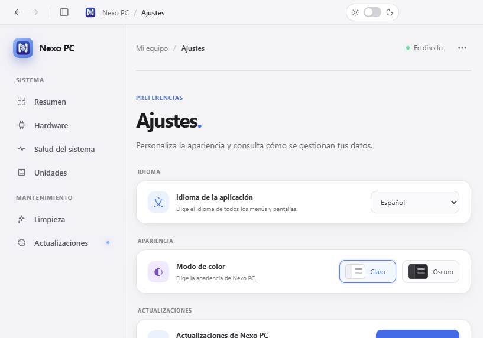

# Nexo PC

**Diagnóstico y mantenimiento local para Windows.** Nexo PC reúne en una sola aplicación el estado del equipo, la telemetría del hardware y herramientas de revisión segura.

## Capturas

Las capturas muestran las siete secciones principales de Nexo PC. Los valores de hardware son de ejemplo y pueden variar según el equipo.

### Resumen

Vista rápida de CPU, memoria, almacenamiento, GPU, actividad del procesador y puntos de control del sistema.



### Hardware y sensores

Consulta los componentes y las lecturas disponibles, filtra por categoría, busca sensores y pausa o restablece el seguimiento de valores mínimos y máximos.



### Salud del sistema

Estado general y comprobaciones disponibles de procesador, memoria, almacenamiento y placa base.



### Unidades

Revisa el espacio de almacenamiento y los detalles de las unidades físicas y lógicas.



### Limpieza segura

Consulta la previsualización de elementos que se pueden revisar. Esta versión no elimina archivos.



### Actualizaciones

Consulta el estado de la aplicación y busca actualizaciones disponibles.



### Ajustes

Configura el idioma y la apariencia, y consulta las opciones de actualización y privacidad.



## Funciones

- **Resumen:** lecturas de CPU, memoria, GPU y discos, además del historial de actividad de CPU.
- **Hardware:** sensores y componentes organizados por categorías, con búsqueda, filtros y seguimiento mín./máx.
- **Salud del sistema:** comprobaciones de hardware y estado general.
- **Unidades:** resumen del almacenamiento, uso y detalles de unidades físicas y lógicas.
- **Limpieza:** previsualización de ubicaciones seguras; no se borra nada.
- **Actualizaciones:** al abrir la aplicación instalada comprueba las releases de GitHub y avisa si hay una versión nueva. La descarga se conserva en la carpeta temporal de Windows, se instala al finalizar y la aplicación se reinicia automáticamente.
- **Ajustes:** cambia entre tema claro y oscuro y permite consultar o iniciar una actualización aunque se haya cerrado el aviso inicial.
- **Exportación:** exporta los datos de la vista actual como TXT o CSV desde el menú de opciones.

Los datos de diagnóstico se recopilan localmente en Windows mediante CIM/WMI. La interfaz se actualiza automáticamente y se adapta a distintos tamaños de pantalla.
Para reducir el uso de CPU y evitar consultas innecesarias, la telemetría se actualiza cada 15 segundos (30 segundos en equipos con 4 hilos o menos) y se pausa mientras la ventana está oculta.

## Requisitos

- Windows 10 versión 1809–22H2 (compilaciones 17763–19045) o Windows 11.
- Instalador disponible para x64.
- Node.js y npm

## Iniciar en desarrollo

```powershell
npm install
npm start
```

`npm start` compila la interfaz y el proceso de Electron antes de abrir la aplicación.

## Comprobar y compilar

```powershell
npm run lint
npm test
npm run build
```

## Crear el instalador de Windows

```powershell
npm run package:win
```

El empaquetado usa NSIS y genera un instalador `.exe` para x64, con la arquitectura indicada en el nombre del archivo. El workflow valida que `latest.yml` corresponda a la versión empaquetada y adjunta tanto ese índice como el `.exe` a la release; electron-builder también genera un `.blockmap` auxiliar para las actualizaciones diferenciales. Si se configuran los secretos de firma `WIN_CSC_LINK` y `WIN_CSC_KEY_PASSWORD`, electron-builder firma el instalador; sin ellos, lo genera sin firmar. El workflow de GitHub Actions actualiza y confirma la versión de `package.json` y `package-lock.json` como `0.1.<número de ejecución>` antes de publicar una release al recibir cambios en `main`.

Para consultar el alcance y las decisiones del producto, revisa [docs/PLAN_INICIAL.md](docs/PLAN_INICIAL.md).
